

# LySono Research Platform

**A research platform built by ultrasound professionals, for ultrasound professionals — empowering every ultrasound physician to become an AI research expert**

_Making AI research no longer the exclusive domain of programmers, and turning innovative ideas into published results, fast_

**[Overview](#overview) · [Feature Map](#feature-map) · [Feature Showcase](#feature-showcase) · [Changelog](#version-changelog) · [Contact Us](#contact-us) · [How to Acknowledge](#how-to-acknowledge)**

---

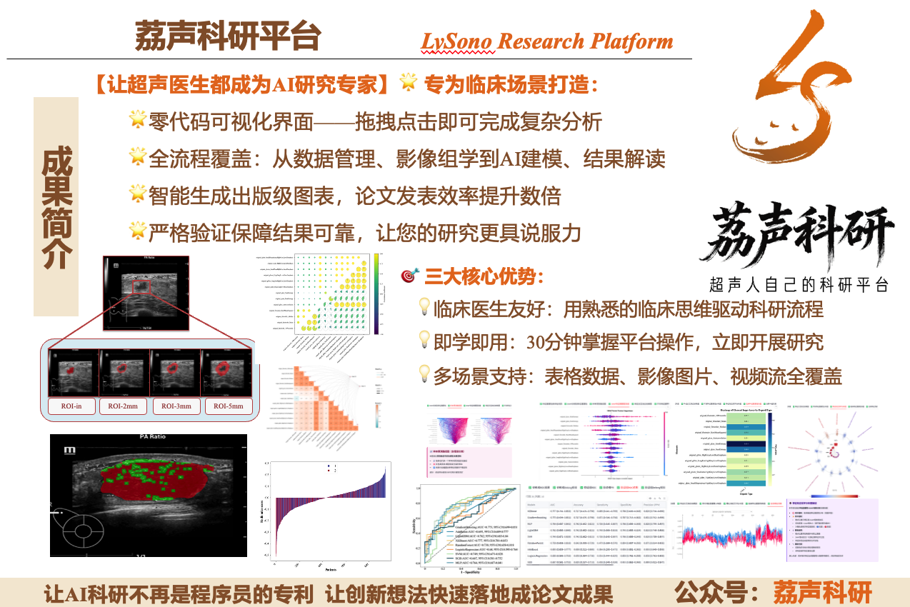

## ✨ Overview

**LySono Research Platform** is a one-stop, no-code, visual analytics platform for medical imaging artificial intelligence, purpose-built for clinical research. It covers the entire research workflow — from image segmentation, radiomics feature extraction, and machine learning modeling to publication-quality figure output.

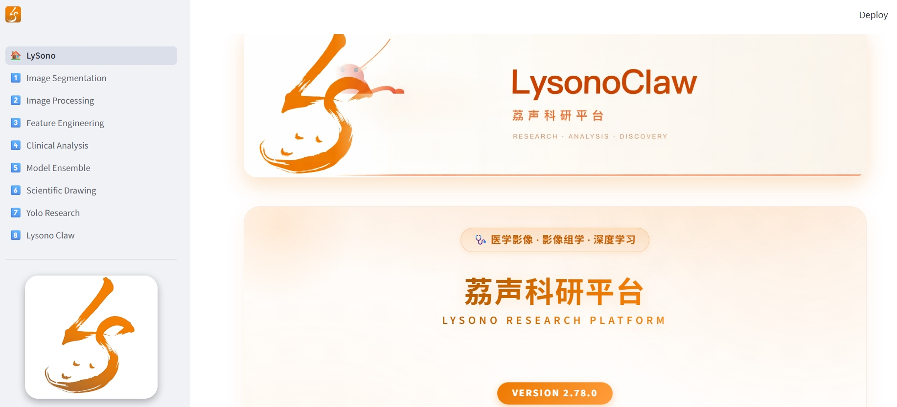

### 🌟 Core Highlights

| Highlight | Description |
|---|---|
| 🖱️ **No-code visual interface** | Complete complex analyses with drag-and-click — no programming background required |
| 🔬 **Full-pipeline coverage** | From data management and radiomics to AI modeling and result interpretation |
| 📊 **Publication-quality figures** | Intelligently generates paper-grade figures, multiplying your publication efficiency |
| ✅ **Rigorous validation** | Reliable, reproducible results that make your research more convincing |

**All operations via mouse clicks**, no programming background needed — complex analysis pipelines made effortless, making research more efficient:
<figure>
<figcaption> Platform module interface </figcaption>
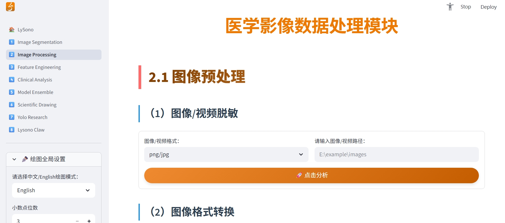
</figure>

### 💡 Three Core Advantages

- 🩺 **Clinician-friendly** — drive your research workflow with familiar clinical thinking
- ⚡ **Learn and use immediately** — master the platform in 30 minutes and start your research right away
- 🗂️ **Multi-scenario support** — full coverage of tabular data, imaging data, and video streams

## 🧩 Feature Map

| Module | Sub-features |
|---|---|
| 🩻 **Medical Image Segmentation** | UNet / nnUNetV2 / MONAI-UNet / SwinUNETR / Habitat Analysis / Peritumoral Region Segmentation / YOLO (v3–v11, 14 attention mechanisms) |
| 🖼️ **Medical Imaging Data Processing** | Image format conversion (DICOM / nii.gz / nrrd / png) / Image preprocessing / Traditional radiomics feature extraction / Deep learning training and feature extraction / Attention heatmaps / Autoencoders / Super-resolution reconstruction / Video models |
| ⚙️ **Feature Engineering** | Training/validation splitting / Resampling / Multi-center batch effect removal / Multi-physician segmentation consistency assessment / T-test / ICC / LASSO / RFE / mRMR / PCA dimensionality reduction |
| 🏥 **Clinical Data Analysis** | Basic statistics / Univariate analysis / Multivariate logistic regression / Correlation analysis / Three-line tables / Survival analysis |
| 🤖 **Model Ensemble** | 14 machine learning models / Stacking / Voting / Bagging / Boosting ensemble / Nomogram modeling / Model testing |
| 🎨 **Scientific Plotting** | Model performance discrimination visualization (ROC / PR / DCA / calibration curves) / Feature visualization (box plots / violin plots / waterfall plots / correlation heatmaps) / SHAP interpretability (importance / dependence / interaction / beeswarm / waterfall·force) / radar·rose charts / model evaluation enhancement / dimensionality reduction·ordination (PCA / PCoA / RDA) / regression·time-series / 3D charts / word cloud — 70+ publication-grade figures |

## 🎨 Feature Showcase

### 🧬 Habitat Analysis

A clustering-based image segmentation pipeline that automates clustering analysis and habitat generation for medical images, extracting radiomics features sub-region by sub-region to characterize intratumoral heterogeneity.

<table>
  <tr>
    <td width="50%">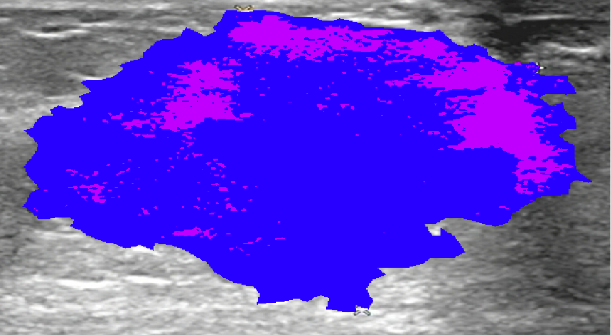</td>
    <td width="50%">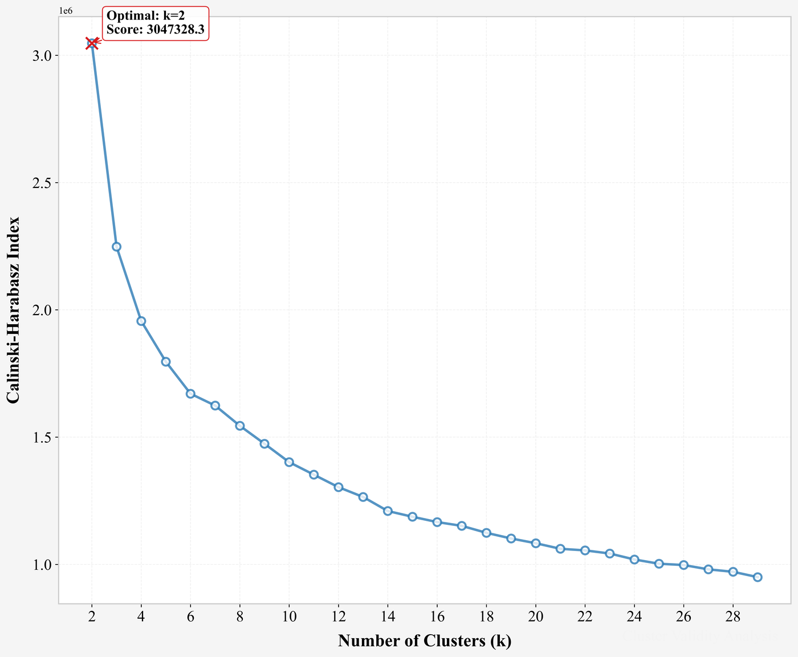</td>
  </tr>
  <tr>
    <td align="center">Automatic cluster-based segmentation of ultrasound tumor habitats (multi-sub-region coloring)</td>
    <td align="center">Automatic optimal cluster number selection via Calinski-Harabasz index</td>
  </tr>
</table>

### 📈 Model Performance Discrimination Visualization

Plot ROC curves (receiver operating characteristic), PR curves (precision-recall), DCA curves (decision curve analysis), and calibration curves for machine learning models. Supports binary and three-class classification, multi-model comparison in a single figure, and automatic annotation of AUC with 95% confidence intervals.

<table>
  <tr>
    <td width="50%">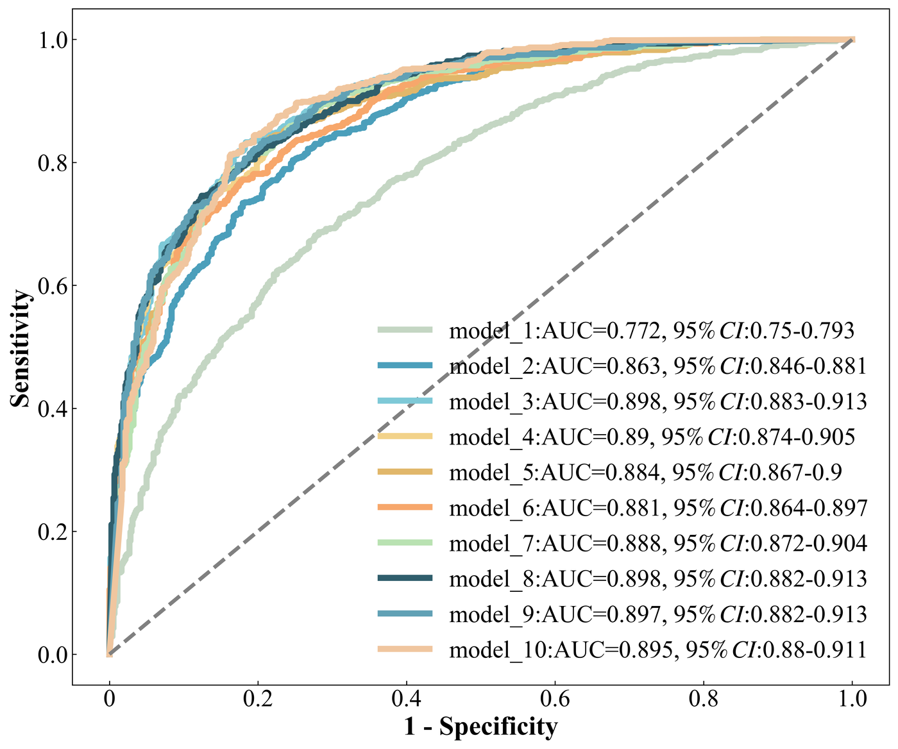</td>
    <td width="50%">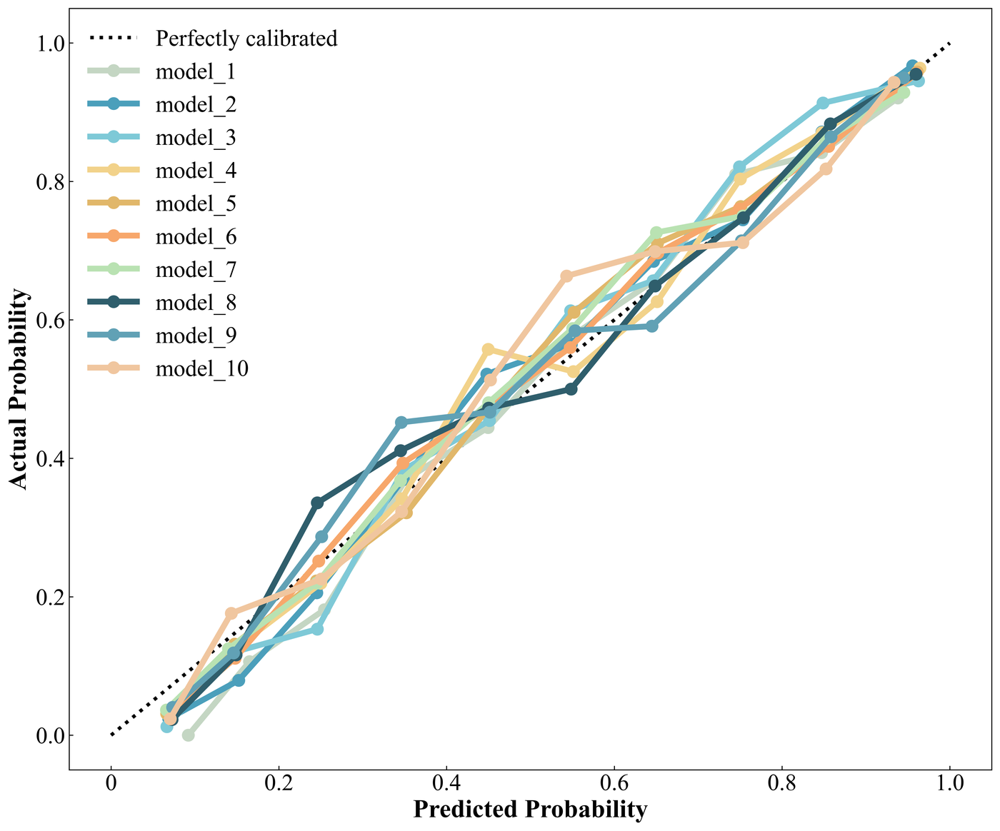</td>
  </tr>
  <tr>
    <td align="center">Multi-model ROC curve comparison (AUC + 95% CI)</td>
    <td align="center">Multi-model calibration curves</td>
  </tr>
</table>

### 🎭 Feature Visualization

Generate box plots, violin plots, waterfall plots, and correlation heatmaps, with automatic between-group difference testing and significance annotation.

<table>
  <tr>
    <td width="50%">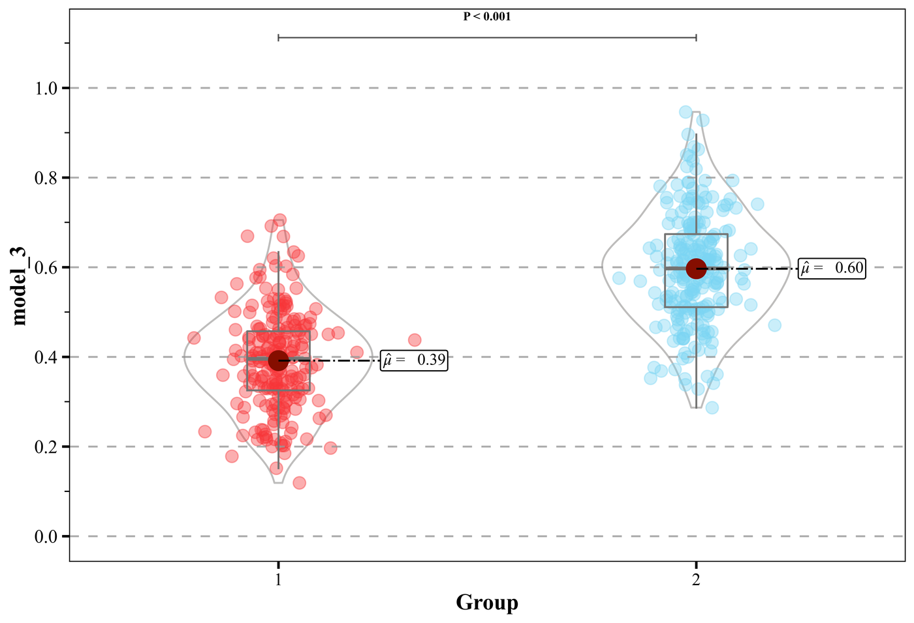</td>
    <td width="50%">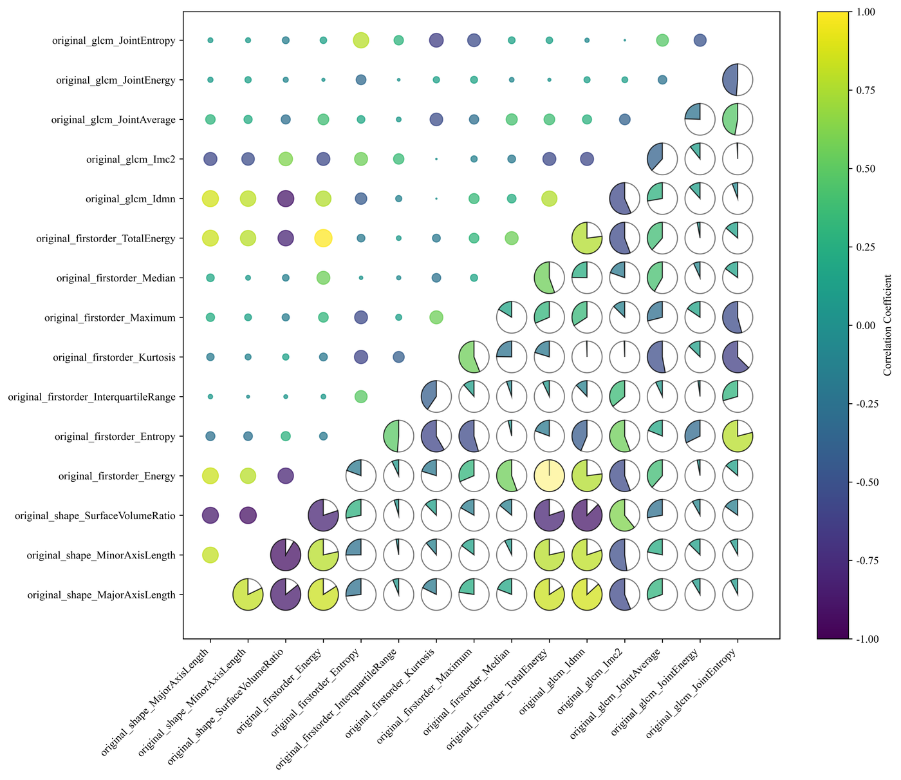</td>
  </tr>
  <tr>
    <td align="center">Between-group feature distribution comparison + significance annotation (P &lt; 0.001)</td>
    <td align="center">Feature correlation pie matrix</td>
  </tr>
</table>

### 🔍 SHAP Interpretability Analysis

SHAP (SHapley Additive exPlanations)-based interpretability analysis of model predictions, showing the contribution of each feature to model predictions and making the AI decision black box transparent.

<table>
  <tr>
    <td width="50%">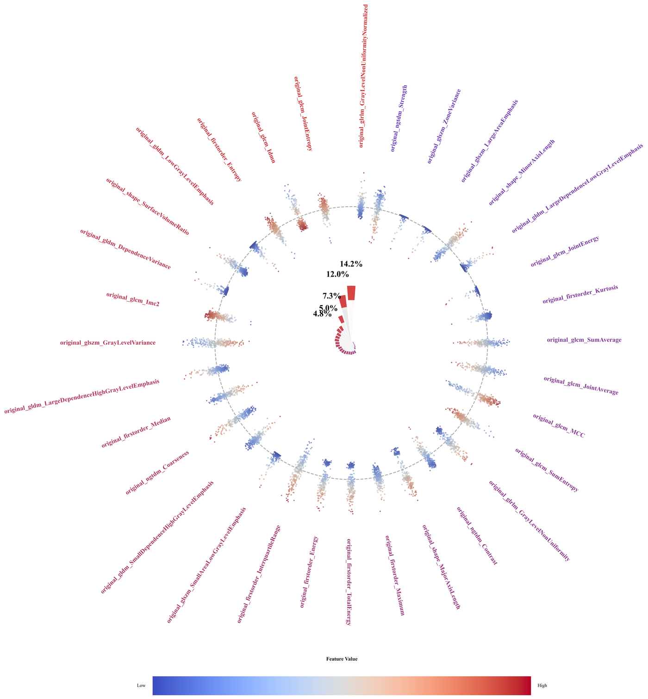</td>
    <td width="50%">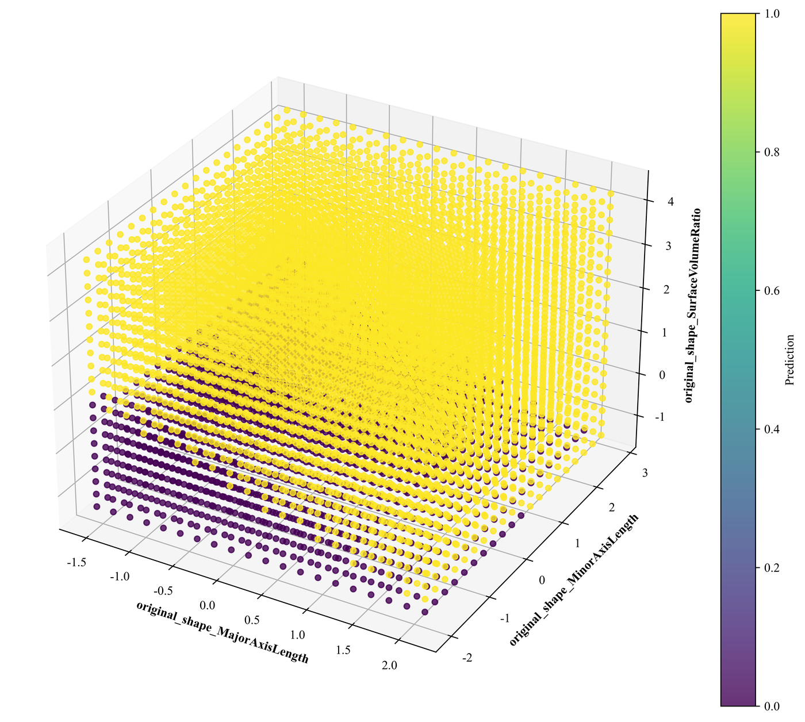</td>
  </tr>
  <tr>
    <td align="center">SHAP radial feature contribution plot (per-feature contribution share)</td>
    <td align="center">SHAP 3D feature interaction decision surface</td>
  </tr>
</table>

## 🚀 Version Changelog

### 🗓️ Recent Updates (2026)

#### 🗓️ 2026-05-18

**✨ Updates**
- ➡️ **Module 1: Medical Image Segmentation → 1.2 Habitat Analysis: Added feature extraction, enabling feature extraction for each sub-region**
- ➡️ **Module 3: Feature Engineering → 3.1 Data Preprocessing → (1) Label merging (optional): Added `label` merging, supporting the merging of `label`s from each class produced by the Habitat Analysis feature extraction module**
- ➡️ **Module 4: Clinical Data Analysis → 4.2 One-click clinical analysis mode: Added `one-click clinical data analysis`, automatically completing the full workflow from three-line table generation to clinical model construction**

**✅ Fixes**
- ➡️ **Module 3: Feature Engineering → 3.1 Data Preprocessing → (1) Training/validation splitting: Fixed order mismatch after splitting**
- ➡️ **Module 4: Clinical Data Analysis → 4.5 Multivariate logistic regression analysis: Fixed the `Singular matrix` error in multivariate analysis**

#### 🗓️ 2026-05-29

**✨ Updates**
- ➡️ **Module 3: Feature Engineering → 3.1 Data Preprocessing → (1) Training/validation splitting: Added two splitting methods: `random stratified split` and `sequential split (by original order)`**
- ➡️ **Module 4: Clinical Data Analysis → Added the option to use `version 1.0` of clinical data analysis**
- ➡️ **Module 7: AI Writing → One-click manuscript generation: It won't ask the truly important question for you, but it can help you validate hypotheses, run experiments, and generate a first draft**

**✅ Fixes**
- ➡️ **Module 1: Fixed the issue where nnunetv2 did not save mask images during segmentation, and fixed the error in unet segmentation when the training device differs from the inference device**
- ➡️ **Module 8: Lysono Claw: Fixed compatibility bugs for better Claw compatibility, generating all required results in one click**

#### 🗓️ 2026-06-06

**✨ Updates**
- ➡️ **Module 2: Medical Imaging Data Processing → 2.3 Deep Learning → (1) Deep learning model training: Added `fine-grained configuration`**
- ➡️ **Module 7: AI Paper Writing → One-click manuscript generation: It won't ask the truly important question for you, but it can help you validate hypotheses, run experiments, and generate a first draft**
- ➡️ **Module 8: Lysono Claw → One-click results: Complete result output simply by chatting with the Lobster**

**✅ Fixes**
- ➡️ **Module 4: Clinical Data Analysis → 4.7 Correlation analysis (optional): Fixed data transfer format issues**

#### 🗓️ 2026-06-24

**✨ Updates**
- ➡️ **Module 2: Medical Imaging Data Processing → 2.3 Deep Learning: Compatible with version 1.0 algorithms**
- ➡️ **Module 2: Medical Imaging Data Processing → 2.3 Deep Learning: Added detailed parameter configuration for learning rate schedulers, loss functions, model-specific parameters, etc.**
- ➡️ **Module 2: Medical Imaging Data Processing → 2.3 Deep Learning → (4) Deep learning video model training: Added video classification training (TimeSformer/C3D) and feature fine-tuning mode**

**🚀 Upcoming**
- ➡️ **New module: Medical Image Segmentation → YOLO models are on the way**

**✅ Fixes**
- ➡️ **Module 3: Feature Engineering → 3.1 Data Preprocessing → (3) Multi-center batch effect removal (optional): Fixed the issue where the V2.0 version output all NaN, causing PCA visualization to fail**
- ➡️ **Module 3: Feature Engineering → 3.2 Feature Selection: Fixed file saving failures in mutual information and RFE**

#### 🗓️ 2026-07-29

**✨ Updates**
- ➡️ **Module 2: Medical Imaging Data Processing → 2.3 Deep Learning → (4) Deep learning video model training: Improved the end-to-end pipeline for TimeSformer/C3D video classification training and feature fine-tuning**
- ➡️ **Module 8: Lysono Claw → AI Writing: Fixed startup crashes caused by gateway configuration validation failures**

**✅ Fixes**
- ➡️ **Module 4: Clinical Data Analysis → 4.5 Multivariate logistic regression analysis: Completely fixed the `Singular matrix` error; both univariate and multivariate analyses no longer crash due to multicollinearity, quasi-complete separation, or small sample sizes**
- ➡️ **Module 1: Medical Image Segmentation → YOLO model training: Fully adapted to environments without NVIDIA GPUs (CPU / macOS)**
- ➡️ **Module 8: Lysono Claw → AI Writing: Fixed gateway startup failures caused by invalid configuration values, with automatic correction of invalid configuration items**
- ➡️ **Module 2: Medical Imaging Data Processing → 2.3 Deep Learning → (1) Deep learning model training: Fixed errors when uploading personal models for training, with unified fixes across all 11 model families**

#### 🗓️ 2026-07-31

**✨ Updates**
- ➡️ **Module 3: Feature Engineering → 3.1 Data Preprocessing → (1) Training/validation splitting: Added PatientID priority matching after resampling, correctly pairing overlapping patients**

**✅ Fixes**
- ➡️ **Module 2: Medical Imaging Data Processing → 2.3 Deep Learning → Deep learning attention heatmaps: Fixed incorrect recognition of multiple model variants including resnet/vit/swin/googlenet**
- ➡️ **Module 3: Feature Engineering → 3.1 Data Preprocessing → (1) Training/validation splitting: Fixed downstream data mismatch caused by missing value imputation**
- ➡️ **Module 3: Feature Engineering → 3.1 Data Preprocessing → (1) Training/validation splitting: Improved label count difference detection prompts, showing actual label count comparisons and modification guidance**

#### 🗓️ 2026-08-04

**✨ Updates**
- ➡️ **Platform-wide compatibility upgrade: Full support for Windows (NVIDIA GPU), macOS (Apple Silicon), and CPU environments, with automatic adaptation across ~40 modules**

**✅ Fixes**
- ➡️ **Fixed multiple crash issues on devices without NVIDIA GPUs; model training and inference now run normally in CPU environments**

#### 🗓️ 2026-08-05

**✅ Fixes**
- ➡️ **Module 1: Medical Image Segmentation → YOLO model training: Fully adapted to environments without NVIDIA GPUs (CPU / macOS)**

#### 🗓️ 2026-08-06

**✨ Updates**
- ➡️ **Module 1: Medical Image Segmentation → YOLO model training: Added an automatic post-training statistics and chart module, with automatic inference on the test set and generation of 14 statistical charts (PR / ROC / F1-confidence / confusion matrix / radar chart, etc.), supporting Chinese and English, PNG / PDF / SVG output, and one-click download**
- ➡️ **Module 2: Medical Imaging Data Processing → 2.3 Deep Learning → (4) Autoencoder feature extraction: Added an autoencoder module (a four-step pipeline: annotation parsing → dataset splitting → training → feature extraction/reconstruction)**
- ➡️ **Module 2: Medical Imaging Data Processing → 2.3 Deep Learning → (1) Deep learning model training: Added real-time line chart visualization of the training process**
- ➡️ **Module 2: Medical Imaging Data Processing → 2.3 Deep Learning → (1) Deep learning model training / (4) Autoencoder feature extraction: Added model deletion**
- ➡️ **Module 2: Medical Imaging Data Processing → 2.3 Deep Learning: Optimized page layout, merging related sub-modules into tabs**

**✅ Fixes**
- ➡️ **Module 2: Medical Imaging Data Processing → 2.3 Deep Learning → (1) Deep learning model training: Fixed errors in resume training from checkpoints**
- ➡️ **Module 2: Medical Imaging Data Processing → 2.3 Deep Learning → (4) Autoencoder feature extraction: Enhanced data pre-checks and error handling**

#### 🗓️ 2026-08-08

**✨ Updates**
- ➡️ **Module 2: Medical Imaging Data Processing → 2.3 Deep Learning → (3) Super-resolution reconstruction: Added a complete super-resolution reconstruction module (GAN training + 4 architectures + 2D/3D)**

**✅ Fixes**
- ➡️ **Module 4: Clinical Data Analysis → Version 2.0: Fixed multiple issues in three-line table generation and univariate/multivariate logistic regression analysis (version 1.0 unaffected)**

#### 🗓️ 2026-08-09

**✨ Updates**
- ➡️ **Module 2: Medical Imaging Data Processing → 2.3 Deep Learning → (4) Autoencoder feature extraction: Continuous UI optimization, merged downloads into a single archive, added best metric recording**

#### 🗓️ 2026-08-11

**✅ Fixes**
- ➡️ **Module 6: Scientific Plotting → 6.2 Feature visualization → (1) Box plots, violin plots: Fixed empty-data errors caused by file reading**
- ➡️ **Module 6: Scientific Plotting: Fixed crash on figure saving when a patient ID column is present (box/violin plots, correlation heatmaps, SHAP, partial dependence plots, Bland-Altman, and 6 other sub-modules)**

#### 🗓️ 2026-08-27

**✨ Updates**
- 🎨 **Homepage refresh: Platform feature map directory + 3×3 application scenario cards**
- Homepage now shows 10 major modules and 40+ sub-feature entries in one screen; each module page has a new current-location indicator at the top; application scenarios expanded to 9 (adding multi-center research and external validation, recurrence monitoring and follow-up prediction)
- 🏷️ **Full multi-label segmentation support (nnUNet + three UNet variants all connected)**
- Added segmentation class settings, supporting custom multi-class labels, with automatic adaptation across the full training/validation/inference chain; inference outputs label value maps + palette color maps; multi-class models output per-class metrics; GradCAM supports multi-class target class selection
- 🔍 **Image format conversion supports multi-label + automatic label type detection**
- Multi-label mode preserves original pixel values, with a new automatic detection feature that determines binary vs. multi-label

**✅ Fixes**
- 🐞 **Fixed a critical issue where nnUNet mistakenly deleted previous results when continuing from a prior training run**
- 🐞 **Fixed nnUNet crashes in the later stages of long training runs**
- 🐞 **Corrected the automatic fallback strategy after mid-training GPU failures in nnUNet (progress already trained is no longer lost)**
- 🐞 **Fixed feature misalignment caused by geometric inconsistency between habitat analysis images and masks**
- 🐞 **Fixed type confusion caused by non-numeric columns in the merged habitat feature table**

#### 🗓️ 2026-09-21

**✨ Updates**
- ➡️ **Module 3: Feature Engineering → 3.1 Data Preprocessing → Added (6) Multi-physician segmentation consistency assessment (optional): pairwise pairing of segmentation masks from two or more physicians, per-case Dice similarity coefficient (DSC) calculation, threshold-based flagging of cases requiring review, results displayed as cards**
- ➡️ **Module 3: Feature Engineering → 3.2 Feature Selection → End-to-end output mode: Added ICC intraclass correlation analysis as the first item**
- ➡️ **Module 2: Medical Imaging Data Processing → 2.1 Image Preprocessing → (2) Image format conversion: Added .nii.gz ↔ .nrrd medical format interconversion (fully preserving geometry and pixel values)**
- ➡️ **Module 1: Medical Image Segmentation → YOLO model training: Tiered pretrained weight sources (official pretrained / my trained models / custom path / none), added deletion of self-trained models**
- ➡️ **Sidebar "Unclosed Tasks" panel redesign: collapsible panel + dropdown selection + height-limited scrolling detail list + one-click clear**
- ➡️ **Module 3: Feature Engineering → 3.1 Data Preprocessing → (6) Multi-physician segmentation consistency assessment: Results display upgraded to card format (mean DSC / range / number of cases assessed / number requiring review)**
- ➡️ **Module 1: Medical Image Segmentation → YOLO model training: Supports multi-GPU distributed training and GPU index specification; automatically falls back to CPU / macOS when no NVIDIA GPU is available**

**✅ Fixes**
- ➡️ **Module 2: Medical Imaging Data Processing → 2.1 Image Preprocessing → (2) Image format conversion: Fixed occasional read failures on network/sync drives that resulted in empty archives; added validation and a prompt to copy data to a local disk first**
- ➡️ **Module 3: Feature Engineering → 3.1 Data Preprocessing → (3) Multi-center batch effect removal: Batch parameters are now estimated only on the training set and then applied to the validation set, eliminating data leakage**
- ➡️ **Module 6: Scientific Plotting → 6.1 Model performance discrimination visualization: Fixed empty archive downloads in folder mode**
- ➡️ **Module 6: Scientific Plotting → DCA area under the curve (AUDC): Confidence intervals changed to patient-level resampling, fixing statistical issues with abnormal confidence intervals**
- ➡️ **Module 3: Feature Engineering → 3.1 Data Preprocessing → (8) External validation group feature selection: Validation group ratio now defaults to 0.00, with added parameter bounds and explanations**
- ➡️ **Module 2: Medical Imaging Data Processing → 2.1 Image Preprocessing → (2) Image format conversion: Fixed mutual overwriting of source folders with the same name and failures reading Chinese paths**
- ➡️ **Module 6: Scientific Plotting → 6.1 Model performance discrimination visualization → DCA / calibration curves: Fixed crashes when data contains patient names or text-number columns**

#### 🗓️ 2026-09-26

**✅ Fixes**
- ➡️ **Module 6: Scientific Plotting → 6.3 SHAP interpretability analysis → (1) Partial dependence plot (PDP), (2) SHAP analysis: Fixed Rad_score feature dimension mismatch errors, added feature alignment validation and friendly prompts, also covering correlation heatmaps and Bland-Altman agreement plots**
- ➡️ **Module 2: Medical Imaging Data Processing → 2.1 Image Preprocessing → (2) Image format conversion: Unified DICOM radiological orientation, fixed inconsistent display orientation (mirroring/rotation) between nii.gz and png**

#### 🗓️ 2026-10-11

**✨ Updates**
- ➡️ **Module 3: Feature Engineering → 3.2 Feature selection → ICC intraclass correlation analysis: parameters simplified to "inter-observer / intra-observer", output upgraded to three tables (filtered A / filtered B / ICC test results) packed for download**
- ➡️ **Module 8: Lysono Claw → Skill management: skill installation supports multi-select for one-click batch installation**

**✅ Fixes**
- ➡️ **Module 3: Feature Engineering → ICC analysis: fixed misalignment between "rater mode" options and the underlying ICC statistical models, and fixed the core filter reading the F-statistic column (causing ineffective filtering)**
- ➡️ **Module 8: Lysono Claw: fixed the lysono-search plugin not being deployed (causing gateway "plugin not found")**

#### 🗓️ 2026-10-15

**✅ Fixes**
- ➡️ **Module 2: Medical Image Data Processing → 2.3 Deep Learning → (1) Deep learning model training: fixed test set metrics being always 0 (imbalanced data caused the minority class to have no test samples due to int truncation), switched to ceiling division to guarantee at least 1 test sample per class**
- ➡️ **Module 2: Medical Image Data Processing → 2.3 Deep Learning → (1) Deep learning model training: fixed ViT families (vision_transformer / transformer / mobilevit / efficientnetV2) AUC being always 0 (ViT training path did not compute/return AUC)**
- ➡️ **Module 2: Medical Image Data Processing → 2.3 Deep Learning → (1) Deep learning model training: unified EfficientNet family naming, fixed dropout / drop_connect params not taking effect**
- ➡️ **Module 2: Medical Image Data Processing → 2.3 Deep Learning → (1) Deep learning model training: fixed pretrained-weight loading error (PyTorch 2.6 compatibility)**
- ➡️ **Module 4: Clinical Data Analysis → 4.2 One-click clinical analysis / 4.5 Multivariate logistic regression: fixed empty standard error / p-value in coefficient table (numerical issue under quasi-complete separation)**

<b>📜 Historical Versions (v3.5.0 → v3.5.5, 2025.07 ～ 2026.03)</b>

| Version | Date | Main Updates |
|---|---|---|
| v3.5.0 | 2025-07-13 | Page restructuring, divided into six major functional modules (Segmentation / Data Processing / Clinical Statistics / Feature Engineering / Model Ensemble / Scientific Plotting) |
| v3.5.1 | 2025-09-09 | Fixed inconsistency between modeling results and ROC plotting results |
| v3.5.2 | 2025-09-10 | Improved sampling methods |
| v3.5.3 | 2025-09-11 | Added multi-center batch effect removal |
| v3.5.4 | 2026-03-01 | Added survival analysis |
| v3.5.5 | 2026-03-08 | Clinical module basic statistical analysis, univariate analysis, clinical prediction model construction |

## 📞 Contact Us

<table>
  <tr>
    <td width="50%" align="center"></td>
    <td width="50%" align="center"></td>
  </tr>
  <tr>
    <td align="center"><b>Customer Service WeChat</b> Scan to add, get trials and support</td>
    <td align="center"><b>WeChat Official Account</b> Search "<b>荔声科研</b>" on WeChat for tutorials and updates</td>
  </tr>
</table>

**Research collaboration, custom feature development, and technical support inquiries are welcome 💬**

## 📖 How to Acknowledge

If this platform has been helpful to your research, please note the following in the Acknowledgements section of your paper:

> Some of the data analyses and experiments in this study were performed using the LySono Research Platform (https://github.com/Jarrily/lysono-research). We thank the LySono team for their technical support of this research.

Platform homepage: [LySono Research Platform (V2.87.0)](https://github.com/Jarrily/lysono-research)

---

 **LySono Research · A research platform built by ultrasound professionals, for ultrasound professionals**

© 2022–2026 LySono Team. All Rights Reserved.

